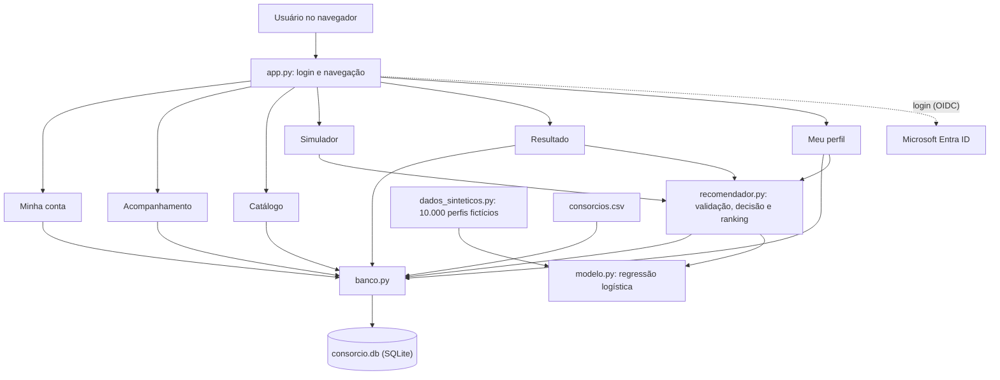
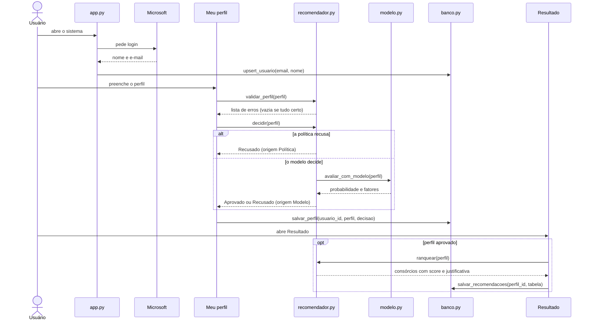
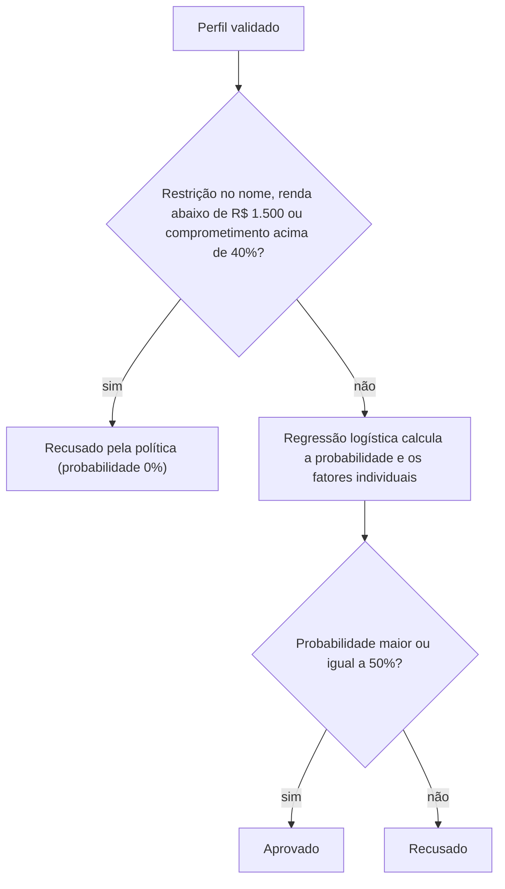
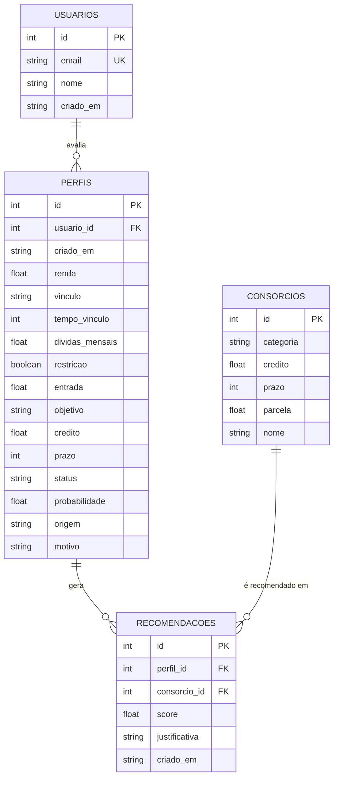

# Arquitetura do sistema: 123 Consórcio

Este documento descreve como o sistema é organizado, como as partes conversam entre si e por que as principais decisões de projeto foram tomadas.

> ⚠️ Todos os dados e decisões do sistema são fictícios. Não é análise de crédito real.

## 1. Visão geral

O 123 Consórcio é uma aplicação web local, executada em **um único processo Streamlit**. Não há uma API REST separada: as páginas da interface chamam diretamente funções dos módulos Python. A integração entre a interface e o motor de recomendação acontece, portanto, por **chamadas de função com um contrato escrito** (nomes, argumentos e formato de retorno definidos em `docs/CONTRATO.md`).

## 2. Camadas e responsabilidades

| Camada | Arquivos | Responsabilidade |
| --- | --- | --- |
| Interface | `app.py`, `paginas/*.py`, `formatacao.py` | Login, navegação, formulários e exibição. **Nenhuma regra de negócio.** |
| Regras e decisão | `recomendador.py` | Validação, indicadores, política de recusa, decisão final, ranking e sugestões de ajuste |
| Inteligência artificial | `modelo.py`, `dados_sinteticos.py` | Geração dos dados de treino, treino, métricas e avaliação de perfis |
| Dados | `banco.py`, `consorcio.db`, `consorcios.csv` | Persistência em SQLite e catálogo inicial |
| Serviço externo | Microsoft Entra ID | Autenticação do usuário (conta Microsoft pessoal) |

## 3. Diagrama de componentes

## 4. Fluxo do usuário

Se a validação encontrar erros, o perfil **não é gravado**: erro de preenchimento não é recusa.

## 5. Decisão em duas camadas

A decisão devolvida por `decidir()` tem sempre o mesmo formato:

| Campo | Conteúdo |
| --- | --- |
| `status` | `"Aprovado"` ou `"Recusado"` |
| `probabilidade` | número de 0 a 1 (chance de aprovação) |
| `origem` | `"Política"` ou `"Modelo"` |
| `motivo` | texto curto explicando a decisão |
| `fatores` | até 3 textos: motivos da recusa (origem Política) ou fatores individuais do modelo (origem Modelo) |

## 6. Modelo de dados

O banco é um arquivo SQLite (`consorcio.db`) criado automaticamente na primeira execução, com o catálogo carregado de `consorcios.csv`. Cada computador tem o seu próprio banco.

## 7. Contrato entre as camadas

| Função | Módulo | Entrada | Saída |
| --- | --- | --- | --- |
| `validar_perfil(perfil)` | `recomendador` | dicionário do perfil | lista de textos de erro |
| `calcular_indicadores(perfil)` | `recomendador` | dicionário do perfil | `parcela_estimada`, `comprometimento`, `entrada_pct`, `credito_renda` |
| `decidir(perfil)` | `recomendador` | dicionário do perfil validado | decisão (seção 5) |
| `ranquear(perfil)` | `recomendador` | dicionário do perfil | tabela com colunas do catálogo, `score` e `justificativa` |
| `sugerir_ajustes(perfil)` | `recomendador` | dicionário do perfil | lista de textos |
| `avaliar_com_modelo(perfil)` | `modelo` | dicionário do perfil | decisão do modelo |
| `upsert_usuario(email, nome)` | `banco` | texto, texto | id do usuário |
| `salvar_perfil(usuario_id, perfil, decisao)` | `banco` | id, perfil, decisão | id do perfil |
| `ultimo_perfil(usuario_id)` | `banco` | id | dicionário ou `None` |
| `listar_consorcios()` | `banco` | nenhuma | tabela do catálogo |
| `salvar_recomendacoes(perfil_id, tabela)` | `banco` | id, tabela | nenhuma |
| `criar_consorcio`, `editar_consorcio`, `excluir_consorcio` | `banco` | dados do consórcio ou id | nenhuma |
| `excluir_dados_usuario(usuario_id)` | `banco` | id | nenhuma |
| `resumo_dashboard()` | `banco` | nenhuma | totais e taxas agregadas, sem dados individuais |

O perfil é um dicionário com as chaves `renda`, `vinculo`, `tempo_vinculo`, `dividas_mensais`, `restricao`, `entrada`, `objetivo`, `credito` e `prazo`.

## 8. Decisões de projeto

- **Um único processo Streamlit, sem API separada.** Mantém o sistema simples de instalar e demonstrar. A separação em camadas (interface, regras, modelo, dados) deixa a evolução para uma API (por exemplo, expor `decidir()` por HTTP) como uma mudança localizada.
- **SQLite.** Não exige servidor nem configuração, usa SQL de verdade e é suficiente para o volume do protótipo.
- **Decisão em duas camadas.** A política barra os casos óbvios de forma determinística e auditável; a IA atua na faixa intermediária, onde há incerteza, e entrega probabilidade e explicação.
- **scikit-learn e regressão logística.** Dados tabulares pequenos pedem um modelo simples. Em comparação com a árvore de decisão, a regressão logística ficou melhor na faixa intermediária, tem probabilidade que varia de forma contínua (importante para o Simulador) e permite explicar cada perfil individualmente. O TensorFlow foi descartado por ser desproporcional ao problema.
- **Treino só com perfis que a política não recusa.** É a variante que melhorou todas as métricas na faixa em que o modelo decide (ver `docs/comparacao_modelos.md`).
- **Dados sintéticos.** Não há dados reais de aprovação; os 10.000 perfis são gerados com distribuições calibradas, rotulados por uma fórmula de pontuação e com 5% de ruído nos rótulos.
- **Interface sem regra de negócio.** As páginas só chamam funções; assim, uma regra muda em um lugar só.
- **Variáveis sensíveis fora da decisão.** Idade, gênero, estado civil, cidade e nome não são coletados nem usados.

## 9. Segurança e privacidade

- O arquivo `.streamlit/secrets.toml` (segredos do login) é protegido pelo `.gitignore` e nunca vai para o GitHub.
- O e-mail da conta Microsoft é gravado no banco; a página **Minha conta** mostra os dados guardados e permite excluí-los.
- A página **Acompanhamento** exibe apenas dados agregados.
- O sistema avisa em todas as telas que os dados e as decisões são fictícios.

## 10. Limitações e evolução

- O modelo aprende a fórmula usada para rotular os dados fictícios, e não a realidade do crédito.
- Perfis na fronteira de aprovação são instáveis; o Simulador existe para explorar esse comportamento.
- Não há papéis de administrador: qualquer usuário logado edita o catálogo.
- Evoluções possíveis: treinar com dados reais anonimizados, expor `decidir()` por uma API, controle de papéis e publicação em nuvem.

## 11. Requisitos do projeto e onde estão atendidos

| Requisito | Implementação |
| --- | --- |
| Cadastro e gestão de usuários | Login Microsoft cria o usuário (`upsert_usuario`); página **Minha conta** consulta e exclui os dados |
| Coleta de perfil | Página **Meu perfil** (9 campos) com validação |
| Cadastro de produtos | Página **Catálogo** (listar, adicionar, editar, excluir) |
| Motor de recomendação com IA | `recomendador.py` + `modelo.py` |
| Interface de recomendação personalizada e transparência | Página **Resultado**: decisão, probabilidade, fatores, justificativas e sugestões de ajuste |
| Simulação de cenários | Página **Simulador** |
| Dashboard simples | Página **Acompanhamento** |
| Integração entre front-end e motor | Chamadas de função entre as camadas, conforme o contrato (seção 7) |
| Documentação técnica | `README.md` e pasta `docs/` |
